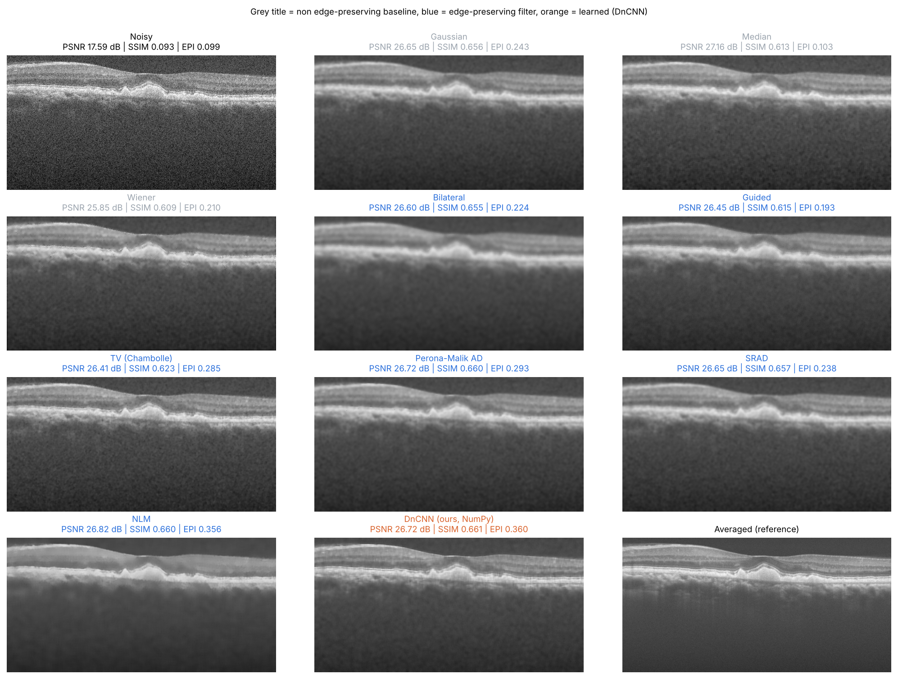
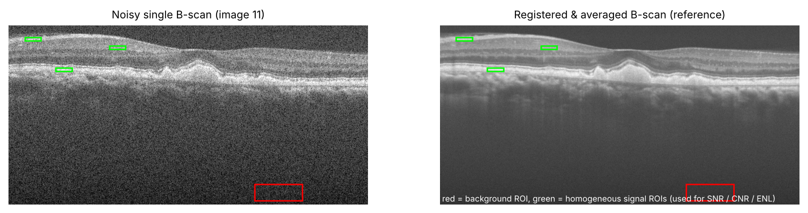
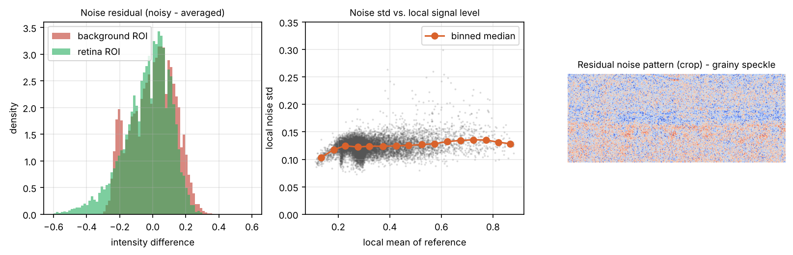
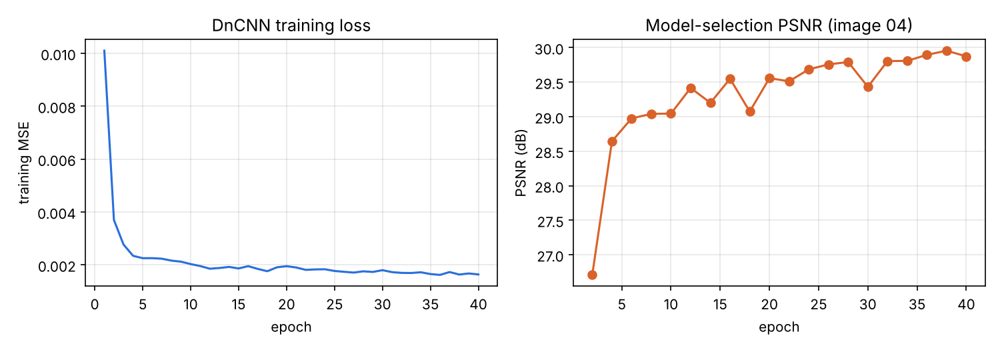
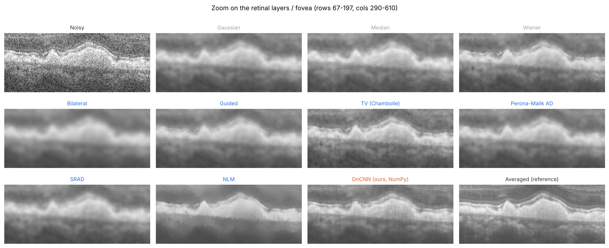
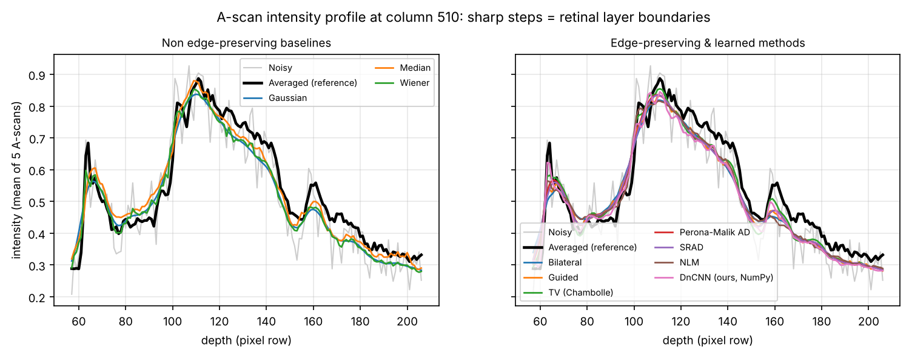
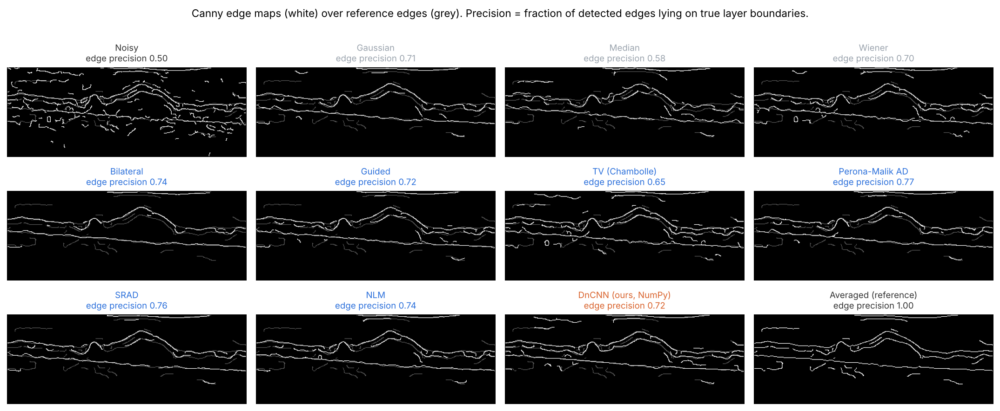
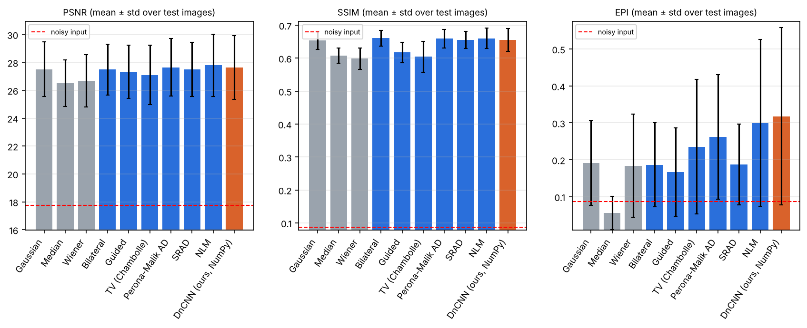
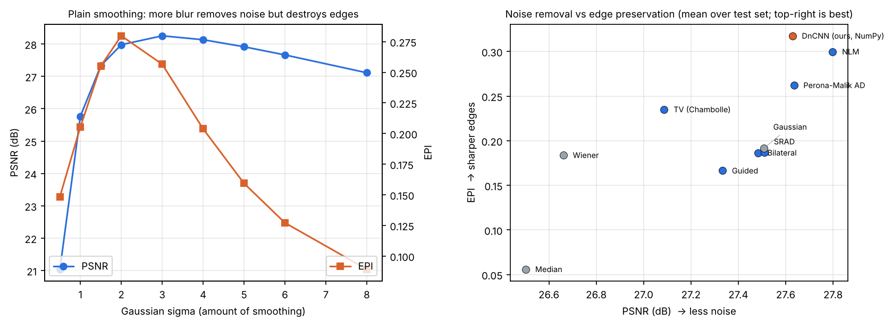
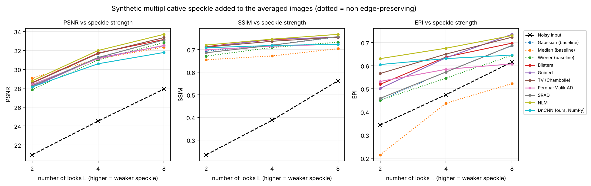

# Edge-Preserving Denoising for Retinal OCT Scans

**Course:** Medical Image Analysis (MIA) – Course Project
**Problem statement 3:** Edge-Preserving Denoising for Retinal OCT Scans
**Team:**

| Name | Roll no. |
|---|---|
| Ashish Singh | 23BCS019 |
| Atithi Jaiman | 23BCS021 |
| Aditya Sharma | 23BCS007 |

> **In one line:** OCT scans of the retina are covered in grainy *speckle* noise. We remove that noise
> while keeping the boundaries between the retinal layers sharp, because those boundaries are what
> doctors and segmentation algorithms rely on.



---

## Contents
1. [Problem & motivation](#1-problem--motivation)
2. [Dataset (with link)](#2-dataset)
3. [Methods](#3-methods)
4. [Experimental protocol](#4-experimental-protocol)
5. [Evaluation metrics](#5-evaluation-metrics)
6. [Results](#6-results)
7. [Discussion & key findings](#7-discussion--key-findings)
8. [How to run](#8-how-to-run)
9. [Project structure](#9-project-structure)
10. [Limitations & future work](#10-limitations--future-work)
11. [References](#11-references)

---

## 1. Problem & motivation

**Optical Coherence Tomography (OCT)** is the standard 3-D imaging technique for the retina. Each
cross-sectional image (a *B-scan*) shows the retinal layers (nerve fibre layer, photoreceptors,
RPE, choroid …). OCT is used to diagnose and monitor diseases such as age-related macular
degeneration (AMD), diabetic macular edema and glaucoma.

OCT works with coherent light, so every scan contains **speckle noise**, a granular pattern that
comes from interference between waves scattered inside the tissue. Speckle:

* hides thin layers and small lesions (drusen, fluid),
* makes automatic layer segmentation and thickness measurement unreliable.

Scanners reduce speckle by **averaging many repeated scans**, but that takes longer and patients
move during the scan. The goal is to get a similar image from **a single noisy scan**.

**Why "edge-preserving"?** Ordinary smoothing (for example a Gaussian blur) removes noise but also
blurs the boundaries between layers, and those boundaries carry the clinical information. An
edge-preserving method should smooth *inside* each layer and stop smoothing *across* layer
boundaries. In this project we implement and compare 10 denoising methods (3 non-edge-preserving
baselines, 6 classical edge-preserving filters and 1 small deep-learning model) and measure both
how much noise they remove and how well they keep the edges.

## 2. Dataset

**Duke SD-OCT denoising dataset** (Fang et al., *Biomedical Optics Express*, 2012). The data is
**included in this project** in the `data/` folder (≈ 17 MB), so no download is needed.

| | |
|---|---|
| **Data link (original)** | https://people.duke.edu/~sf59/Fang_BOE_2012.htm (dataset list: https://people.duke.edu/~sf59/software.html) |
| **Data link (mirror used here)** | https://github.com/ashkan-abbasi66/MIFCN (folders `RESULTS/dt1_Bioptigen_SDOCT` and `data/`) |
| **Re-download script** | `python scripts/download_data.py` |
| Scanner | Bioptigen SD-OCT, normal and AMD eyes (A2A SD-OCT clinical trial) |
| Evaluation images | 18 pairs: a **noisy** single B-scan + a **registered & averaged** B-scan (high-SNR ground truth), 450 × 900 px |
| Training patches | 4 000 noisy/clean 15 × 15 patch pairs from **10 different** training B-scans (used only for the DnCNN) |

Splits (fixed and never mixed):

| Split | Images | Used for |
|---|---|---|
| Development | 01–04 | Tuning the filters' hyper-parameters (grid search); DnCNN extra patches (01–03) and best-epoch selection (04) |
| **Test** | **05–18 (14 images)** | **Every number reported below.** Never used for tuning or training. |

See `data/README.md` for the full description and the citation the dataset authors require.



### Noise analysis



The difference between the noisy and averaged images (left) has a standard deviation of about
**0.12** (on a 0–1 scale) and depends only weakly on the signal level (middle). This matches the
standard model of speckle: it is *multiplicative* in linear intensity, which turns roughly
*additive* after the log-compression OCT scanners apply for display. We use this observation to
build the synthetic experiment in §6.4.

## 3. Methods

All methods are in `src/oct_denoise/filters.py` and `src/oct_denoise/dncnn.py`. Inputs and
outputs are float images in [0, 1].

### 3.1 Non edge-preserving baselines
| Method | Idea | What happens to edges |
|---|---|---|
| **Gaussian** | Weighted average with a Gaussian kernel | Blurs everything the same amount, edges included |
| **Median** | Median of a k × k window | Removes outliers, but turns thin layers into blocks |
| **Wiener** | Adaptive filter based on local mean and variance | Smooths less where local variance is high, but cannot tell edges from noise |

### 3.2 Edge-preserving filters
| Method | Key idea (how edges are protected) |
|---|---|
| **Bilateral** (Tomasi & Manduchi 1998) | Weight = spatial Gaussian × *intensity* Gaussian. Pixels on the other side of an edge have very different intensity and get almost no weight. |
| **Guided filter** (He et al. 2013) | Fits a local linear model `q = a·I + b`. In flat regions `a → 0` (strong smoothing); at edges `a → 1` (the edge is copied). |
| **Total Variation** (Rudin-Osher-Fatemi, Chambolle 2004) | Minimises `‖u−f‖² + λ·TV(u)`. TV penalises small oscillations (noise) but allows sharp jumps (edges), giving a piecewise-smooth result. |
| **Perona-Malik anisotropic diffusion** (1990) | Iterates the heat equation with a conductance `c(|∇I|)` that is ≈ 1 in flat areas and ≈ 0 at strong gradients, so diffusion **stops at edges**. |
| **SRAD** (Yu & Acton 2002) | Anisotropic diffusion built for speckle. The edge detector is the local *coefficient of variation* instead of the gradient. |
| **Non-Local Means** (Buades et al. 2005) | Averages pixels whose surrounding *patches* look similar, wherever they are in the image. The layered structure of the retina repeats along each layer, so there are plenty of similar patches. Patches across an edge differ, so edges are kept. |

### 3.3 Learned method: DnCNN (implemented from scratch in NumPy)
A 6-layer residual CNN in the style of DnCNN (Zhang et al., 2017):
`Conv3×3(1→32)+ReLU → 4 × [Conv3×3(32→32)+ReLU] → Conv3×3(32→1)`. The network predicts the
**noise**, and the output is `noisy − predicted noise`. Training uses MSE loss and Adam (lr 1e-3
with step decay) for 40 epochs, with flip and rotation augmentation and reflect padding.

* **No deep-learning framework is needed.** Convolution (im2col), back-propagation and Adam are
  written in about 200 lines of NumPy and pass a numerical gradient check. The model trains on a
  laptop CPU in about 25 minutes, and the trained weights (`models/dncnn_numpy.npz`, 140 kB) are
  included.
* **Training data:** the 4 000 Duke training patches, plus random 40 × 40 patches from
  development images 01–03. The extra patches add background context that the retina-only
  patches lack. The best epoch was chosen on image 04.



## 4. Experimental protocol

1. **Hyper-parameter tuning:** each filter gets a grid search over its parameters (grids are in
   `filters.METHODS`; 6–36 settings per method). The setting with the highest mean PSNR on
   development images 01–04 is kept (`results/best_params.json`, full grid in
   `results/tuning_grid_search.csv`).
2. **Testing:** every method is run with its chosen parameters on the 14 test images (05–18)
   and scored with 6 metrics. We report mean ± standard deviation across images.
3. **Statistics:** a Wilcoxon signed-rank test (paired, per image) compares the best method
   with each of the others.
4. **Controlled experiment:** synthetic speckle of known strength (Gamma-distributed,
   L = 2, 4, 8 looks) is added to the *averaged* images. Each method is re-tuned per noise level
   on 01–04 and tested on 05–18.

Chosen parameters:

| Method | Best parameters |
|---|---|
| Gaussian | σ = 3.0 |
| Median / Wiener | window 9 × 9 |
| Bilateral | σ_color = 0.8, σ_space = 5 |
| Guided | r = 4, ε = 0.16 |
| TV | weight = 0.16 |
| Perona-Malik | 30 iterations, κ = 0.1, conductance option 2 |
| SRAD | 100 iterations, dt = 0.2, q0 decay = 0.05 |
| NLM | h = 1.0·σ̂, patch 7 × 7, search distance 10 |

## 5. Evaluation metrics

| Metric | Type | Meaning |
|---|---|---|
| **PSNR** (dB) | full-reference | Overall closeness to the averaged image (noise removal) |
| **SSIM** | full-reference | Similarity of local structure, contrast and luminance |
| **EPI**, Edge Preservation Index | full-reference | Correlation between the high-pass (Laplacian) content of the output and of the reference. **Main edge metric:** 1 means every edge is kept; both leftover noise and blurred edges lower it. |
| **SNR** (dB) | no-reference | `10·log10(max² / σ²_background)` |
| **CNR** | no-reference | Contrast between retinal layers and background, `|μs−μb| / √(σs²+σb²)` |
| **ENL** | no-reference | Equivalent number of looks, `μ²/σ²` in homogeneous layers (smoothness) |

SNR, CNR and ENL are the usual OCT metrics and need no ground truth. The regions they are
measured in (red = background, green = homogeneous layers, figure above) are picked
automatically from the reference image and are the same for every method.

## 6. Results

### 6.1 Main table: real OCT noise, 14 test images (mean ± std)

| Method | Edge-preserving | PSNR (dB) ↑ | SSIM ↑ | EPI ↑ | SNR (dB) ↑ | CNR ↑ | ENL ↑ | Time (s) |
|---|:---:|---|---|---|---|---|---|---|
| Noisy input | – | 17.75 ± 0.46 | 0.087 ± 0.020 | 0.086 ± 0.071 | 18.10 ± 0.50 | 2.18 ± 0.66 | 24.3 ± 9.0 | 0.00 |
| Gaussian | no | 27.51 ± 1.96 | 0.654 ± 0.027 | 0.192 ± 0.115 | 34.65 ± 0.80 | 13.06 ± 4.24 | 902.7 ± 496.9 | 0.01 |
| Median | no | 26.50 ± 1.68 | 0.608 ± 0.023 | 0.056 ± 0.045 | 31.77 ± 1.01 | 9.98 ± 2.99 | 558.6 ± 261.2 | 0.49 |
| Wiener | no | 26.66 ± 1.88 | 0.599 ± 0.032 | 0.184 ± 0.140 | 33.59 ± 0.92 | 9.88 ± 2.90 | 516.2 ± 308.4 | 0.03 |
| Bilateral | yes | 27.48 ± 1.82 | **0.661 ± 0.024** | 0.187 ± 0.114 | 36.10 ± 1.01 | 16.70 ± 5.82 | 1722.8 ± 996.8 | 0.11 |
| Guided | yes | 27.33 ± 1.92 | 0.617 ± 0.030 | 0.166 ± 0.120 | 33.35 ± 0.68 | 12.09 ± 3.90 | 766.8 ± 375.4 | 0.01 |
| TV (Chambolle) | yes | 27.09 ± 2.13 | 0.604 ± 0.047 | 0.235 ± 0.182 | 32.43 ± 1.20 | 10.00 ± 3.27 | 494.4 ± 288.1 | 0.05 |
| Perona-Malik AD | yes | 27.63 ± 2.06 | 0.659 ± 0.028 | 0.262 ± 0.169 | 35.03 ± 0.84 | 13.50 ± 4.22 | 987.0 ± 555.7 | 0.13 |
| SRAD | yes | 27.51 ± 1.94 | 0.655 ± 0.026 | 0.187 ± 0.109 | 34.68 ± 0.82 | 13.39 ± 4.37 | 986.0 ± 549.5 | 1.47 |
| **NLM** | yes | **27.80 ± 2.23** | 0.660 ± 0.031 | 0.300 ± 0.226 | **37.37 ± 1.19** | **16.79 ± 5.97** | **1894.9 ± 1266.4** | 0.98 |
| **DnCNN (ours, NumPy)** | learned | 27.63 ± 2.29 | 0.655 ± 0.035 | **0.318 ± 0.240** | 36.44 ± 1.10 | 11.66 ± 3.61 | 629.6 ± 319.0 | 3.72 |

Times are per 450 × 900 image on a 2-core CPU. Per-image values are in
`results/test_metrics_per_image.csv`. The large standard deviations mostly reflect differences
*between images* (some scans are much noisier than others). The paired tests below take this into
account.

### 6.2 Is the difference real? Wilcoxon signed-rank test against NLM (n = 14)

| NLM compared with | ΔPSNR (dB) | p | ΔEPI | p |
|---|---|---|---|---|
| Gaussian | +0.29 | 0.009 | +0.108 | 0.009 |
| Median | +1.30 | <0.001 | +0.244 | 0.002 |
| Wiener | +1.14 | <0.001 | +0.116 | 0.002 |
| Bilateral | +0.32 | 0.068 | +0.113 | 0.002 |
| Guided | +0.47 | 0.002 | +0.133 | 0.002 |
| TV | +0.71 | <0.001 | +0.065 | 0.002 |
| Perona-Malik | +0.16 | 0.042 | +0.038 | 0.035 |
| SRAD | +0.29 | 0.025 | +0.113 | 0.007 |
| DnCNN | +0.17 | 0.013 | **−0.018** | 0.042 |

NLM has significantly higher PSNR than every method except Bilateral (p = 0.07). **DnCNN keeps
edges significantly better than NLM** (EPI 0.318 vs 0.300, p = 0.04). Full table:
`results/wilcoxon_vs_best.csv`.

### 6.3 Visual results

**Zoom on the fovea.** Gaussian, Median and Bilateral give a soft, blurred band; NLM and DnCNN
separate the individual layers.


**Intensity profile along one depth line (A-scan).** Each step in the black reference curve is a
layer boundary. The baselines (left) round the steps off; the edge-preserving methods (right)
follow them more closely.


**Canny edges (test image 11).** Only about half of the edges found in the noisy image lie on real
layer boundaries (precision 0.50); the Median filter reaches only 0.58. The edge-preserving filters
reach 0.72–0.77, with Perona-Malik the highest on this image (0.77), and they keep the layer
contours continuous.


**Metric bar charts**


### 6.4 Noise removal vs edge preservation, and synthetic speckle



**Left:** making the Gaussian blur stronger keeps raising PSNR up to σ = 3, but EPI peaks at σ = 2
and then **drops sharply** (−54 % by σ = 6). Tuning for PSNR alone therefore picks an over-smoothed image, which is
exactly why an edge metric is needed. **Right:** NLM and DnCNN sit in the top-right corner, with
both the least noise and the sharpest edges.



With controlled speckle (L = 2 is strongest), **NLM has the best PSNR at L = 4 and 8 and the best EPI at L = 2 and 4** (at L = 8 the Guided filter edges it on EPI, 0.736 vs 0.730).
At the strongest noise (L = 2) the Median filter gets the highest PSNR (29.07 dB) but by far
the **worst EPI (0.21)**, which is another case where a high PSNR hides destroyed edges. DnCNN was
trained only on real Duke noise, so it does less well on this artificial noise (it generalises
less across noise types), but it still has the second-best EPI at L = 2.

## 7. Discussion & key findings

1. **Every method improves the image a lot**: PSNR rises from 17.8 dB to about 27–28 dB and CNR
   from 2.2 to up to 16.8.
2. **PSNR alone is misleading.** The tuned Gaussian blur matches SRAD and Bilateral on PSNR
   (27.5 dB) but has a low EPI, and the Median filter's EPI (0.056) is **worse than the noisy
   input** (0.086). The edge metrics (EPI, edge maps, A-scan profiles) separate the methods much
   more clearly than PSNR does.
3. **Non-Local Means is the best classical method overall**: highest PSNR, SNR, CNR and ENL, and
   the second-best EPI. It works well because the retina is layered, so every patch has many
   similar patches along the same layer.
4. **The DnCNN keeps edges best (EPI 0.318).** Even this small CNN, trained on only 10 images,
   matches the best classical filters on PSNR. Its lower ENL means it leaves a little more
   texture in flat regions instead of over-smoothing them.
5. **Perona-Malik diffusion has the best speed/quality balance** (0.13 s per image, third-best
   PSNR and EPI). SRAD, despite being designed for speckle, does no better than Perona-Malik
   here. The Duke images are already log-compressed, so the speckle is close to additive, which
   removes SRAD's advantage.
6. **Recommendation:** use **NLM** as a robust, training-free default and **DnCNN** when edge
   sharpness matters most, for example as a step before layer or choroid segmentation (problem
   statements 1 and 2 of the course).

## 8. How to run

Requirements: Python ≥ 3.9 and the packages below. No GPU and no PyTorch or TensorFlow are needed.

```bash
pip install -r requirements.txt          # numpy scipy scikit-image opencv-python matplotlib pandas

# (optional) the data is already in data/, but it can be fetched again:
python scripts/download_data.py

# 1) train the DnCNN (~25 min on CPU; pre-trained weights are already in models/)
python train_dncnn.py

# 2) full pipeline: tuning, test evaluation, statistics, synthetic experiment, figures (~13 min)
python run_experiments.py
python run_experiments.py --quick        # fast check (~2 min)
python run_experiments.py --figures-only # only redraw the figures from the saved results

# 3) denoise one image (a dataset image or your own)
python demo.py --image_id 11                       # all methods, image 11
python demo.py --input my_oct.png --method NLM     # your own scan
python demo.py --list                              # list the method names
```

Everything is deterministic (fixed random seeds). Running the commands above reproduces the
numbers in this README.

## 9. Project structure

```
OCT_Edge_Preserving_Denoising/
├── README.md                     <- this report
├── requirements.txt
├── run_experiments.py            <- tuning + evaluation + statistics + figures
├── train_dncnn.py                <- trains the NumPy DnCNN
├── demo.py                       <- denoise a single image
├── scripts/download_data.py      <- re-downloads the dataset
├── src/oct_denoise/
│   ├── data.py                   <- loading + train/dev/test split
│   ├── filters.py                <- 9 classical filters + tuning grids
│   ├── dncnn.py                  <- CNN from scratch (im2col conv, backprop, Adam)
│   ├── metrics.py                <- PSNR, SSIM, EPI, SNR, CNR, ENL + automatic regions
│   ├── speckle.py                <- synthetic multiplicative speckle model
│   └── visualize.py              <- all figures
├── data/
│   ├── README.md                 <- data description, links, citation
│   ├── duke_oct_test/01..18/     <- noisy.tif + average.tif
│   └── train_patches/            <- 4 000 15×15 training pairs (.npz)
├── models/dncnn_numpy.npz        <- trained DnCNN weights
└── results/
    ├── test_metrics_summary.(csv|md), test_metrics_per_image.csv
    ├── wilcoxon_vs_best.csv, best_params.json, tuning_grid_search.csv
    ├── synthetic_speckle_(summary|per_image).csv
    ├── dncnn_training_curve.png, dncnn_training_history.json, *_log.txt
    ├── figures/01..09_*.png
    └── denoised_examples/image_11/*.png   <- output of every method on one test image
```

## 10. Limitations & future work

* **The "ground truth" is itself an average** of registered scans. It still has some residual
  noise and slight misregistration, which limits the reachable PSNR (published methods get
  about 26–28 dB on this dataset).
* **The dataset is small** (14 test images, one scanner). Results on other devices (Spectralis,
  Cirrus) may differ.
* **The DnCNN is small** (6 layers, about 38 k parameters) and trained on very little data.
  Possible improvements: a larger U-Net on GPU, self-supervised training (Noise2Noise or
  Noise2Void, which need no averaged scans), or a perceptual or edge-aware loss.
* **Next step:** measure the effect *downstream*, by checking whether denoising improves
  automatic layer or choroid segmentation (problem statements 1 and 2).
* BM3D and wavelet methods were not included because they need extra packages
  (`bm3d`, `PyWavelets`). They can be added to the `filters.METHODS` registry in a few lines.

## 11. References

1. L. Fang, S. Li, Q. Nie, J. A. Izatt, C. A. Toth, S. Farsiu, "Sparsity based denoising of spectral domain optical coherence tomography images," *Biomed. Opt. Express* 3(5):927–942, 2012. (**dataset**)
2. A. Abbasi, A. Monadjemi, L. Fang, H. Rabbani, Y. Zhang, "Three-dimensional optical coherence tomography image denoising through multi-input fully-convolutional networks," *Computers in Biology and Medicine* 108:1–8, 2019. (data mirror)
3. C. Tomasi, R. Manduchi, "Bilateral filtering for gray and color images," *ICCV*, 1998.
4. K. He, J. Sun, X. Tang, "Guided image filtering," *IEEE TPAMI* 35(6), 2013.
5. L. Rudin, S. Osher, E. Fatemi, "Nonlinear total variation based noise removal algorithms," *Physica D*, 1992; A. Chambolle, "An algorithm for total variation minimization and applications," *JMIV*, 2004.
6. P. Perona, J. Malik, "Scale-space and edge detection using anisotropic diffusion," *IEEE TPAMI* 12(7), 1990.
7. Y. Yu, S. T. Acton, "Speckle reducing anisotropic diffusion," *IEEE TIP* 11(11), 2002.
8. A. Buades, B. Coll, J.-M. Morel, "A non-local algorithm for image denoising," *CVPR*, 2005.
9. K. Zhang, W. Zuo, Y. Chen, D. Meng, L. Zhang, "Beyond a Gaussian denoiser: residual learning of deep CNN for image denoising (DnCNN)," *IEEE TIP* 26(7), 2017.
10. F. Sattar, L. Floreby, G. Salomonsson, B. Lövström, "Image enhancement based on a nonlinear multiscale method," *IEEE TIP* 6(6), 1997. (EPI)
11. Z. Wang, A. C. Bovik, H. R. Sheikh, E. P. Simoncelli, "Image quality assessment: from error visibility to structural similarity," *IEEE TIP* 13(4), 2004. (SSIM)
